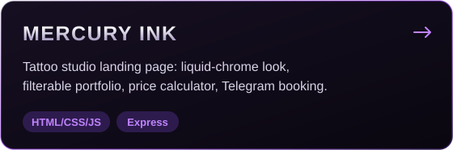
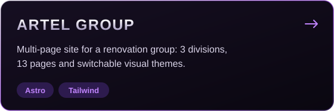
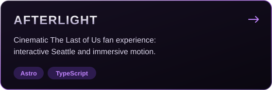
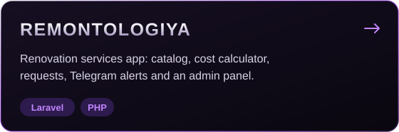
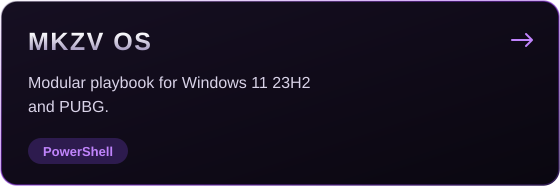
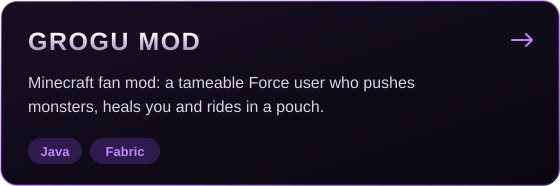

 
 

 

## About me

I'm Maxim, a full-stack developer and web designer. I take on the whole project: from a Figma prototype to production-ready code, with smooth animation and thoughtful UX on the way.

- **Frontend:** landing pages and multi-page sites with TypeScript, React, Astro and Tailwind
- **Backend:** web apps and admin panels with Node.js, PHP, Laravel and MySQL
- **Open to new projects:** message me on [Telegram](https://t.me/mkzvwork)

 

## Selected work

 

## Tools

 

 
 

